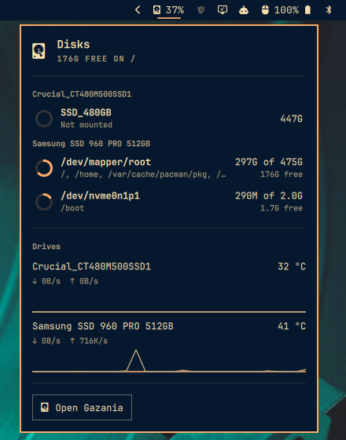

# Omarchy Gazania

Free space, disk throughput and drive temperature in the
[Omarchy](https://omarchy.org) bar, with a panel listing every volume. Data
comes from [Gazania](https://github.com/brianirish/gazania)'s `gazania watch`
stream, so the widget never polls the disks itself.

## Install

    omarchy plugin add https://github.com/brianirish/omarchy-gazania --enable

### Requirements

- Omarchy 4 or newer
- The `gazania` package, version 0.2 or newer, which provides `gazania` and
  `gazania-app`

## What it shows

- **In the bar:** a disk glyph and one stat: free space on a volume, read and
  write throughput of a drive, or that drive's temperature. The whole widget,
  glyph and text, turns to a warning color, then an error color, as the volume
  fills up; for temperature it turns to the error color when the drive reports
  a SMART failure.
- **In the panel:** every volume, grouped by drive, with a usage ring, its
  mount points and how much is used and free; then each drive's temperature,
  current throughput and a 30-second sparkline; and a button that opens
  Gazania.
- **Keys in the panel:** Up and Down or `j` and `k` move the highlight
  between volumes. Enter or Space opens the highlighted volume in Gazania, or
  opens Gazania itself when nothing is highlighted. Clicking a volume opens it
  in Gazania too. Tab and Shift+Tab move between panels, Escape closes the
  panel.

## Settings

Edit the widget's entry in `~/.config/omarchy/shell.json`; the bar reloads on
save. For example, to show the NVMe drive's temperature:

    { "id": "brianirish.gazania", "barStat": "temperature", "drive": "/dev/nvme0n1" }

Or from the command line:

    omarchy bar set brianirish.gazania barStat temperature

| Setting | Default | Meaning |
| --- | --- | --- |
| `barStat` | `free` | What follows the glyph: `free` (percent free on `volume`), `io` (read and write per second on `drive`), `temperature` (of `drive`) or `none`. |
| `volume` | `/` | Mount point the bar tracks. Any mount point of a btrfs subvolume works. When it is not mounted, the bar tracks `/`, and if that is missing too the first mounted volume; the tooltip says so. |
| `drive` | empty | Device for `io` and `temperature`, such as `/dev/sda`. Empty means the drive that holds `volume`. |
| `warnAt` | `85` | Percent used at which the bar text and the panel rings take the warning color. |
| `criticalAt` | `95` | Percent used at which they take the error color. |
| `showIo` | `true` | Show throughput and the sparkline in the panel. |
| `showTemperature` | `true` | Show temperature in the panel. |

## Key binding

The panel can be driven from a keybinding with
`omarchy-shell brianirish.gazania toggle` (or `open` / `close`).

## How it works

Each bar runs one `gazania watch` process and reads its JSON lines: volumes at
start, within 300 ms of a mount change and every 30 seconds; throughput every
second; health every minute. If the process exits, the widget starts it again
after 2 seconds, backing off to 30. Colors come from the active Omarchy theme:
the accent for normal levels, the theme's urgent color for errors, and an even
blend of the two for warnings, since themes define no warning color.

## Troubleshooting

- **The glyph is dimmed and the tooltip says to install gazania:** the
  `gazania` command is not on `PATH`. Install the package; the widget checks
  again every minute.
- **The tooltip says to update gazania:** the installed version is older than
  0.2, or its stream reports a protocol this widget does not know. The widget
  stops retrying in that state; after updating, restart the shell with
  `omarchy restart shell`.
- **No temperature for a drive:** many USB enclosures hide SMART data.
  `gazania health` shows the same gap.
- **Anything else:** `journalctl --user --since '10 minutes ago' | grep -i -e qml -e gazania`
  and `timeout 3 gazania watch` usually show the cause.

## Development

See [CONTRIBUTING.md](CONTRIBUTING.md). In short: keep logic in `Model.js`,
test it with `node tests/model_test.js`, and run `scripts/check` before
opening a pull request.

## Uninstall

    omarchy plugin remove brianirish.gazania

## License

MIT, see [LICENSE](LICENSE).
